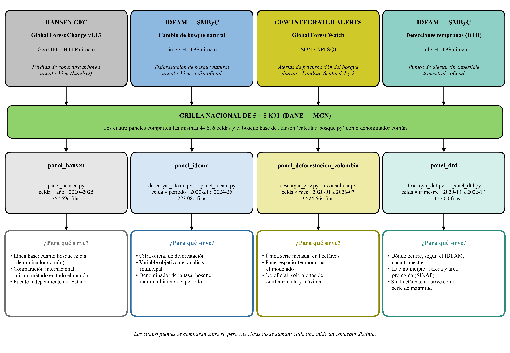

# 1. Fuentes de datos

El trabajo usa dos grupos de fuentes:

- **Las fuentes propias de deforestación.** Son públicas y satelitales, y
  las descarga el pipeline (Pasos 1 a 10 de
  [`2_DESCARGA_DE_DATOS.md`](2_DESCARGA_DE_DATOS.md)).
- **Las fuentes del Observatorio Financiero Rural**: crédito, producción
  agropecuaria y catálogo de municipios. Están en BigQuery, en el proyecto
  del profesor (`prueba-ofr`), y se leen con la llave de la cuenta de
  servicio (Paso 14).

Además hay dos fuentes auxiliares: la cartografía del DANE, que da la
estructura espacial, y las imágenes Landsat, que solo usa la demo.

Este documento dice qué es cada fuente y para qué se usa. El porqué de cada
elección está en [`referencia/METODOLOGIA.md`](referencia/METODOLOGIA.md), sección 2. Las
columnas, los tipos y una muestra de cada tabla están en
[`columnas/DESCRIPCION_FUENTES.md`](columnas/DESCRIPCION_FUENTES.md) y
[`columnas/DESCRIPCION_FUENTES_PROFESOR.md`](columnas/DESCRIPCION_FUENTES_PROFESOR.md), que se
generan con los Pasos 12 y 13.

---

## Índice

1. [Resumen](#1-resumen)
2. [Fuentes propias de deforestación](#2-fuentes-propias-de-deforestación)
3. [Fuentes del Observatorio](#3-fuentes-del-observatorio)
4. [Fuentes auxiliares](#4-fuentes-auxiliares)

---

## 1. Resumen

| Fuente | Qué mide | Periodo que se usa | Cómo se accede | Alimenta |
|---|---|---|---|---|
| **GFW**, alertas integradas | Alertas de disturbio de la vegetación | 2020-01 a 2026-07, por mes | API de Global Forest Watch, con API key gratuita | `panel_deforestacion_colombia` |
| **Hansen GFC** | Cobertura arbórea del año 2000 y año de pérdida | Pérdida 2020-2025, por año | Descarga directa, sin cuenta | El bosque base de las cuatro tablas y `panel_hansen` |
| **IDEAM**, capas de cambio | Deforestación oficial de bosque natural | 2020-2021 a 2024-2025 | Descarga directa del SMByC, sin cuenta | `panel_ideam` |
| **IDEAM**, detecciones tempranas | Puntos de alerta oficiales | 2020-T1 a 2026-T1, por trimestre | Descarga directa del SMByC, sin cuenta | `panel_dtd` |
| **FINAGRO** | Desembolsos de crédito agropecuario | 2020 a 2026-06 | BigQuery del Observatorio | Crédito del panel municipal |
| **SFC 414** | Desembolsos de crédito por municipio | 2023-09 a 2026-10 | BigQuery del Observatorio | Solo el análisis exploratorio |
| **Catálogo de municipios** | Nombre, región y ruralidad de cada municipio | Clasificación más reciente | BigQuery del Observatorio | Ruralidad y región del panel municipal |
| **EVA** | Área sembrada y cosechada, y producción, por cultivo | 2019 a 2024 | BigQuery del Observatorio | Cultivos del panel municipal |
| **ICA pecuario** | Inventario pecuario por municipio | 2020 a 2025 | BigQuery del Observatorio | Ganado del panel municipal |
| **DANE**, Marco Geoestadístico | Límites departamentales y municipales | MGN 2023 y 2025 | Servicio público de ArcGIS, sin cuenta | La grilla y el código de municipio (`cod_dane`) |
| **Landsat 8 y 9** | Reflectancia de la superficie | 2022 y 2023, en una zona piloto | Microsoft Planetary Computer, sin cuenta | Solo la demo de Landsat |

---

## 2. Fuentes propias de deforestación

Las cuatro se cruzan sobre una misma grilla de 5 × 5 km y quedan en cuatro
tablas separadas, porque miden cosas distintas: sus cifras no se suman entre
sí. Cada una responde una pregunta que las otras no pueden responder
([`referencia/METODOLOGIA.md`](referencia/METODOLOGIA.md), sección 1.2).

### GFW: alertas integradas de disturbio

- **Qué es.** El producto `gfw_integrated_alerts` de Global Forest Watch,
  que integra tres sistemas de alerta:
  - GLAD-L, de Landsat;
  - GLAD-S2, de Sentinel-2;
  - RADD, de radar Sentinel-1.

  Señala dónde cambió la vegetación, casi en tiempo real.
- **Qué se usa.** Las alertas de confianza alta y muy alta, sumadas en
  hectáreas por celda y por mes.
- **Pregunta que responde.** *¿Cuándo?* Es la fuente con más resolución
  temporal.
- **Acceso.** API de Global Forest Watch (`data-api.globalforestwatch.org`),
  con una API key gratuita (`python main_local.py configurar-gfw`).
- **Detalle.** [`referencia/METODOLOGIA.md`](referencia/METODOLOGIA.md), sección 2.2.

### Hansen Global Forest Change

- **Qué es.** El producto global de cobertura y pérdida de bosque de la
  Universidad de Maryland y Google, a 30 m, actualizado cada año.
- **Qué se usa.** Dos capas:
  - `treecover2000` y `lossyear` para el **bosque base**, el denominador
    común de las cuatro tablas;
  - la pérdida de cada año, para `panel_hansen`.
- **Pregunta que responde.** *¿Cómo se compara con otros países?* Aplica el
  mismo algoritmo en todo el planeta. Cuenta toda pérdida de cobertura
  arbórea, incluidas la cosecha de plantaciones y los incendios.
- **Acceso.** Descarga directa de los gránulos desde
  `storage.googleapis.com/earthenginepartners-hansen`, sin cuenta (~2 GB).
- **Detalle.** [`referencia/METODOLOGIA.md`](referencia/METODOLOGIA.md), sección 2.1.

### IDEAM: capas de cambio de bosque

- **Qué es.** La cifra oficial de deforestación de Colombia, del Sistema de
  Monitoreo de Bosques y Carbono (SMByC) del IDEAM, a partir de imágenes de
  satélite.
- **Qué se usa.** Los rásteres de cambio de cada periodo anual, sumados por
  celda. La suma reproduce entre el 99,65 % y el 99,84 % de la cifra oficial
  publicada.
- **Pregunta que responde.** *¿Cuánto, oficialmente?* Usa la definición
  nacional de bosque natural.
- **Acceso.** Descarga directa del servidor del SMByC
  (`bart.ideam.gov.co/smbyc`), sin cuenta (~260 MB).
- **Detalle.** [`referencia/METODOLOGIA.md`](referencia/METODOLOGIA.md), sección 2.3.

### IDEAM: detecciones tempranas (DTD)

- **Qué es.** Los puntos de alerta temprana de deforestación que publica el
  SMByC cada trimestre.
- **Qué se usa.** El número de puntos por celda y trimestre.
- **Pregunta que responde.** *¿Dónde, con respaldo oficial?* Es el único
  producto oficial con cadencia menor a un año. Sirve para ubicar, no para
  medir área: el número de puntos depende también del esfuerzo de monitoreo.
- **Acceso.** Descarga directa de archivos KML del servidor del SMByC, sin
  cuenta (~167 MB).
- **Detalle.** [`referencia/METODOLOGIA.md`](referencia/METODOLOGIA.md), sección 2.4.

---

## 3. Fuentes del Observatorio

Son cinco tablas de solo lectura en el proyecto de BigQuery del profesor
(`prueba-ofr`). Se leen con la llave de la cuenta de servicio
`pipeline-satelital`, que no es pública (ver
[`2_DESCARGA_DE_DATOS.md`](2_DESCARGA_DE_DATOS.md), sección 1.5).
`panel_municipal_armado.ipynb` las descarga a `datos/profesor/` y arma con
ellas el panel municipal.

### FINAGRO: desembolsos de crédito

- **Tabla.** `prueba-ofr.Inclusion_Financiera.FINAGRO_Desembolsos_EFECTIVA`
  (6,2 millones de filas, 37 columnas).
- **Qué tiene.** Cada crédito agropecuario desembolsado con recursos de
  FINAGRO entre 2010 y junio de 2026: fecha, municipio, monto, tipo de
  productor, cadena productiva y eslabón de la cadena.
- **Qué se usa.** El panel municipal toma:
  - el crédito total;
  - el del **eslabón de producción** (el 92 % de los créditos), total y
    por cadena: ganadería, palma de aceite, cacao, café y arroz.

  Los montos van en millones de pesos corrientes, sin ajustar por
  inflación.
- **Cuidado.** Tiene tasas de interés negativas y periodos de gracia
  atípicos. Se ven en la estadística descriptiva y no afectan los montos
  que se usan.

### SFC 414: desembolsos por municipio

- **Tabla.** `prueba-ofr.Inclusion_Financiera.SFC414_DASH` (2,0 millones de
  filas, 17 columnas).
- **Qué tiene.** El formato 414 de la Superintendencia Financiera: montos y
  número de créditos desembolsados por municipio, con tipo de persona, sexo,
  tipo de crédito, tipo de garantía y tasa efectiva promedio. Va de
  septiembre de 2023 a octubre de 2026.
- **Qué se usa.** Solo el análisis exploratorio
  (`exploratorio_sfc414.ipynb`). No entra en el panel municipal porque su
  serie empieza en septiembre de 2023.

### Catálogo de municipios

- **Tabla.** `prueba-ofr.Municipios.CODIGO` (20.196 filas: una por
  municipio y año, de 2005 a 2026).
- **Qué tiene.** El código DANE, el nombre, el departamento, la región y la
  **ruralidad** de cada municipio según el DNP, en cuatro categorías:
  ciudades y aglomeraciones, intermedio, rural y rural disperso.
- **Qué se usa.** La región y la ruralidad. Se toma la clasificación más
  reciente y queda fija para todos los años. El análisis y los modelos usan
  solo los municipios rurales y rurales dispersos.
- **Cuidado.** No incluye el municipio 27493 (Nuevo Belén de Bajirá, el más
  nuevo del país), que sí tiene datos en las demás fuentes. Ver
  `investigacion_municipio_27493.ipynb`.

### EVA: evaluaciones agropecuarias municipales

- **Tabla.** `prueba-ofr.Produccion.eva_full_enriquecido` (347.141 filas,
  23 columnas).
- **Qué tiene.** El área sembrada y cosechada, la producción y el
  rendimiento de cada cultivo, por municipio y semestre, de 2006 a 2024. El
  Observatorio la enriqueció con un cruce entre los nombres de los cultivos
  de la EVA y las cadenas de FINAGRO.
- **Qué se usa.** El **área cosechada**, no la sembrada, en total y por
  cultivo. Se suman los semestres y las variantes de un mismo cultivo.
- **Cuidado.** No mide pastos ni coca, y no tiene 2025.

### ICA pecuario: inventario pecuario

- **Tabla.** `prueba-ofr.Produccion.ICA_pecuario` (8.976 filas, 142
  columnas).
- **Qué tiene.** El censo pecuario del ICA por municipio y año, de 2018 a
  2025: bovinos por edad y sexo, fincas con bovinos, y también búfalos,
  porcinos, aves, ovinos, caprinos y equinos.
- **Qué se usa.** El total de bovinos y el de fincas con bovinos.
- **Cuidado.**
  - En 2025 el ICA reasigna bovinos entre municipios vecinos: más de 100
    municipios cambian más de 50 % frente a 2024. Por eso la segmentación
    usa 2021-2024.
  - El Observatorio advirtió que esta tabla puede tener inconsistencias.

---

## 4. Fuentes auxiliares

### DANE: Marco Geoestadístico Nacional

- **Qué se usa.**
  - Los límites departamentales del MGN 2023, para recortar la grilla al
    territorio continental.
  - Los límites municipales del MGN 2025, para asignar a cada celda su
    código de municipio (`cod_dane`) y para los mapas.
- **Acceso.** Servicio público de ArcGIS del DANE, sin cuenta. Licencia
  CC BY 4.0.
- **Detalle.** [`referencia/METODOLOGIA.md`](referencia/METODOLOGIA.md), sección 2.5.

### Landsat 8 y 9

- **Qué se usa.** Solo en la demo
  ([`4_DEMO_LANDSAT.md`](4_DEMO_LANDSAT.md)), que replica en una zona piloto
  de Caquetá el cálculo con que los productos publicados detectan pérdida
  de bosque. No alimenta ninguna tabla.
- **Acceso.** Catálogo STAC de Microsoft Planetary Computer, sin cuenta. Se
  lee solo el recorte de la zona.
